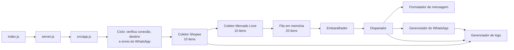
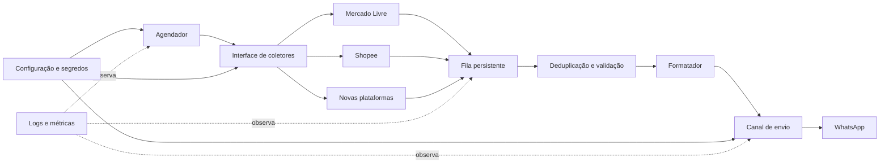

# Robô de mensagens de promoções

## 1. Visão geral

Este projeto automatiza a coleta de ofertas em plataformas de comércio eletrônico, transforma os dados dos produtos em mensagens promocionais e envia essas mensagens pelo WhatsApp.

No estado atual, os fluxos da Shopee e do Mercado Livre estão conectados à execução principal. Antes de cada ciclo, o robô conecta o WhatsApp, verifica o destino e confirma um envio de teste para a própria conta. Somente após essa confirmação, escolhe uma categoria em cada plataforma, coleta primeiro 10 produtos da categoria da Shopee e depois 10 produtos da categoria do Mercado Livre. O lote completo de 20 itens é embaralhado e somente então entregue ao disparador, usando a mesma sessão já verificada.

Quando todos os produtos são enviados, a fila fica vazia e as duas coletas recomeçam na mesma sequência. Em caso de falha, os itens não enviados permanecem na fila e cada coletor completa somente a cota de sua própria origem no ciclo seguinte.

Esta documentação descreve somente aspectos técnicos. Identificadores de usuários, grupos, telefones, contas e credenciais das plataformas não são reproduzidos.

## 2. Objetivos do projeto

- Automatizar a descoberta de produtos e promoções.
- Gerar mensagens com informações essenciais do produto.
- Distribuir as mensagens pelo WhatsApp com espaçamento entre os envios.
- Permitir a inclusão futura de novas origens, como Shopee e outras plataformas.
- Reduzir tarefas manuais relacionadas à coleta, formatação e publicação das ofertas.

## 3. Estado atual

| Componente | Estado | Observação |
|---|---|---|
| Coleta no Mercado Livre | Funcional e ativa | Lista as categorias visíveis na área de afiliados, alterna entre elas e coleta 10 itens por lote. |
| Coleta na Shopee | Funcional e ativa | Lista categorias pela API GraphQL, alterna entre 30 categorias atualmente disponíveis e coleta 10 itens filtrados. |
| Fila de produtos | Funcional, em memória | Reúne 10 itens de cada loja, é embaralhada antes do envio e perde seu conteúdo ao encerrar o processo. |
| Embaralhamento | Funcional | Usa Fisher–Yates em uma cópia da fila, sem perder, duplicar ou alterar os objetos coletados. |
| Formatação de mensagens | Funcional | Normaliza título, categoria, preço e link e usa a mensagem como legenda da imagem. |
| Envio pelo WhatsApp | Parcialmente funcional | Usa uma sessão local e depende de autenticação e de um destino previamente acessível. |
| API HTTP | Somente infraestrutura | O Express inicia um servidor, mas não há rotas HTTP definidas atualmente. |
| Logs | Funcional | Winston grava logs gerais e de erro em arquivos locais e, fora de produção, também no console. |
| Testes automatizados | Funcionais | A suíte cobre categorias, coletores, cotas por origem, lote, embaralhamento, mensagens, imagens e integração isolada com o gerenciador de mensagens. |

## 4. Arquitetura atual

A aplicação é um monólito Node.js executado como um único processo. Coleta, fila, agendamento e envio compartilham memória e ciclo de vida.



### Responsabilidades dos módulos

#### Inicialização

- `index.js`: ponto de entrada definido pelo comando `npm start`; carrega o servidor.
- `server.js`: importa a aplicação Express e abre a porta `3000`.
- `src/app.js`: cria a aplicação Express, habilita leitura de JSON, mantém a fila compartilhada e inicia o ciclo contínuo de coleta e disparo.
- `src/ciclo.js`: conecta e verifica o WhatsApp antes das coletas, executa os coletores, valida e embaralha o lote e aciona o disparador com a mesma sessão. Encerra o cliente ao fim de cada tentativa e registra erros antes de aguardar 60 segundos para tentar novamente.

Importante: o processamento começa como efeito colateral da importação de `src/app.js`. O servidor HTTP e o robô não possuem ciclos de vida independentes.

#### Coleta do Mercado Livre

- `src/coletor.js`: abre um Chromium visível por meio do Puppeteer e reutiliza um perfil local do navegador.
- Reutiliza a aba inicial do Chromium e fecha as demais abas encontradas na inicialização, incluindo possíveis abas restauradas do perfil; só cria uma aba quando não existe nenhuma.
- Acessa a área de afiliados, aplica filtros predefinidos e procura cards de produtos no HTML.
- A espera e o clique dos filtros usam o mesmo critério de texto, visibilidade e habilitação, ignorando links e cards. Se um controle não estiver disponível em até 15 segundos, registra o nome do controle e recarrega a página na mesma aba para uma segunda tentativa. Uma categoria que continuar indisponível é descartada naquele ciclo, incluindo seus itens pendentes, e o coletor avança sem ler cards de um filtro não aplicado. Falhas nos controles gerais "Mais vendidos" ou "Categorias" encerram a tentativa após duas falhas e preservam a fila.
- Para cada card, extrai título, preço e URL da imagem, aciona a geração do link de afiliado e lê o link pela área de transferência do navegador.
- Adiciona objetos no formato `{ titulo, preco, link, imagemUrl, categoria, origem }` à fila.
- Completa uma cota de `10` itens do Mercado Livre, sem considerar produtos da Shopee que já estejam na fila.
- Ignora, dentro da fila atual, produtos com links duplicados.
- Mantém em memória o índice do próximo card, de modo que cada novo ciclo continue depois dos cards processados anteriormente.
- Descobre as categorias diretamente no seletor da área de afiliados e alterna uma categoria por lote.
- Ignora "Cupons" e "Ingressos" antes de aplicar o filtro, pois não contêm cards de produtos. Para qualquer outra categoria sem cards ou sem produtos suficientes para completar a cota, faz até três tentativas de rolagem e espera pelo carregamento; se a cota continuar incompleta, descarta os itens daquela categoria e segue para a próxima na mesma aba, retornando à primeira quando chega ao fim da lista. Se nenhuma categoria completar a cota, encerra a tentativa com erro após uma volta, sem entrar em loop infinito; o ciclo principal tenta novamente após 60 segundos.
- Mantém um índice de card independente para cada categoria; ao retornar a uma categoria, continua depois dos itens já percorridos nela.
- Quando chega ao fim dos cards carregados, rola a página e aguarda novos resultados em vez de recarregar imediatamente a mesma listagem.
- Quando a categoria esgota os cards antes de completar a cota, remove da fila todos os produtos do Mercado Livre daquela categoria, inclusive resíduos de ciclos anteriores, preservando os itens das demais origens e categorias. Recalcula a cota e a deduplicação, reinicia o cursor da categoria descartada e avança com um aviso no log. Dez cards não garantem dez produtos válidos: itens duplicados ou sem imagem também podem impedir que a categoria complete a cota.
- Falhas técnicas de navegação, desconexão ou carregamento continuam sendo propagadas, preservando os produtos pendentes. O descarte ocorre quando a listagem é esgotada sem completar a cota ou quando a opção de uma categoria permanece indisponível após duas tentativas de seleção.
- Fecha explicitamente as abas antes de encerrar o navegador ao terminar a coleta ou quando ocorre erro. Falhas na limpeza das abas não impedem a tentativa de encerrar o navegador. O perfil e o login são preservados, e o navegador é reaberto no próximo ciclo.

Esse coletor depende fortemente de textos, seletores CSS e comportamento da interface da plataforma. Alterações no site podem interromper a automação mesmo sem mudanças no projeto.

#### Coleta da Shopee

- `src/coletor-shopee.js`: integra a API GraphQL de afiliados por meio da operação `productOfferV2`.
- Assina o corpo exato da requisição com SHA-256 e lê as credenciais de variáveis de ambiente.
- Lista as categorias disponíveis por meio de `shopeeOfferV2`, selecionando somente ofertas do tipo categoria.
- A verificação controlada realizada em setembro de 2026 retornou 30 categorias para a credencial configurada; essa quantidade é dinâmica e pode mudar na plataforma.
- Traduz para português os nomes atualmente conhecidos e preserva o nome fornecido pela API como fallback para novas categorias.
- Filtra `productOfferV2` pelo identificador `productCatId` e solicita páginas de 10 produtos até preencher a cota da Shopee.
- Alterna uma categoria por lote e mantém em memória uma página independente para cada categoria.
- Volta à página 1 somente quando a API informa que não existe uma página seguinte.
- Prefere `offerLink`, que contém o rastreamento de afiliado, e usa o link comum apenas como fallback.
- Converte cada item para o contrato `{ titulo, preco, link, imagemUrl, categoria, origem, idExterno }` usado pelo disparador.
- Ignora produtos duplicados ou incompletos com logs de aviso.
- Quando uma consulta de produtos retorna somente o erro GraphQL `10000` (`System Error`), registra a causa, stack, categoria, ID e página no nível `error` e avança para a próxima página na mesma coleta. O cursor é atualizado imediatamente, e os produtos já capturados são preservados durante esse avanço.
- Limita o avanço a três páginas com erro consecutivas por categoria; uma página consultada com sucesso reinicia essa contagem. Ao atingir o limite em um lote novo, aplica a regra de categoria incompleta: descarta os itens adicionados daquela categoria e tenta a próxima, até completar uma volta. Se houver produtos residuais de um lote anterior, preserva-os e encerra a tentativa para o ciclo principal tentar novamente após 60 segundos, começando pela página avançada. Isso evita um loop infinito quando a API permanece indisponível.
- Autenticação recusada, rate limit, timeout, erro HTTP, resposta inválida e respostas com outros códigos GraphQL continuam interrompendo a coleta e gerando logs. Erros na listagem inicial de categorias também são propagados, pois o avanço de página com `10000` se aplica à consulta de produtos.
- Em um lote novo, ignora uma categoria sem produtos suficientes e tenta a categoria seguinte; a coleta só é interrompida depois que todas as opções disponíveis forem esgotadas, impedindo a criação de um lote incompleto.

#### Composição e embaralhamento do lote

- `src/ciclo.js` executa o coletor da Shopee antes do coletor do Mercado Livre, somente após a confirmação do WhatsApp.
- `src/lote.js` centraliza as cotas e valida a composição obrigatória do lote.
- Cada coletor conta somente itens de sua própria origem. Isso permite recompor corretamente um lote residual depois de falhas de envio.
- Uma categoria permanece ativa enquanto houver itens residuais daquela origem; a próxima categoria é escolhida depois que a fila correspondente zera. No Mercado Livre, se a categoria não conseguir completar a cota após esgotar os cards ou continuar indisponível após duas tentativas de seleção, seus itens residuais são descartados e a próxima categoria é tentada na mesma coleta.
- O disparador só é chamado quando a fila contém exatamente 10 itens de cada loja, totalizando 20.
- `src/embaralhador.js` aplica o algoritmo Fisher–Yates a uma cópia do array; em seguida, o orquestrador substitui a ordem da fila pelo resultado.
- Depois que os 20 envios são confirmados e removidos da fila, o laço contínuo reinicia ambas as coletas.

#### Disparo de mensagens

- `src/disparador.js`: recebe a fila e a sessão já verificada, inclui a categoria de cada produto na legenda e prepara um atraso aleatório de `1` a `10` minutos para cada item. Quando chamado isoladamente, inicializa e verifica seu próprio cliente.
- Baixa a imagem do produto, valida tipo e tamanho e cria uma mídia real do WhatsApp; a mensagem textual é enviada como legenda.
- Cada imagem possui timeout de `20` segundos, limite de `10` MB e até `3` tentativas de download.
- Se a imagem continuar indisponível, a mensagem não é enviada sem imagem e o produto permanece na fila para uma tentativa futura.
- Cada tarefa recebe um item exclusivo, formata a mensagem e realiza o envio. O item somente é removido da fila depois da confirmação do envio.
- Os temporizadores são criados em paralelo sobre o lote já embaralhado. Portanto, a ordem real também depende dos atrasos sorteados, e vários itens podem ser enviados praticamente ao mesmo tempo quando recebem atrasos iguais.
- O disparador espera todas as tarefas terminarem e preserva na fila os itens que falharem. No fluxo principal, o orquestrador encerra a sessão ao fim da tentativa; na execução isolada, o próprio disparador a encerra. Cada erro de envio é registrado com sua causa e stack, além do resumo de falhas do lote.
- A regra de localização do destino está atualmente embutida no código. Por segurança e flexibilidade, ela deve migrar para configuração externa; nenhum dado desse destino é registrado neste documento.

O disparador valida de forma síncrona que recebeu exatamente 20 itens. Como coleta e disparo são sequenciais, ele não fica aguardando uma fila ser preenchida em paralelo.

#### Integração com WhatsApp

- `src/gerenciador-mensagens.js`: cria o cliente de `whatsapp-web.js` com autenticação local.
- Exibe um QR Code no terminal quando uma nova autenticação é necessária.
- Trata os eventos de cliente pronto, falha de autenticação e desconexão.
- Aguarda o evento `ready` por até 120 segundos e captura também rejeições assíncronas de `initialize()`. Falhas e timeouts são registrados como erros e impedem as coletas.
- Antes de cada coleta, exige estado `CONNECTED`, localiza o grupo configurado e envia uma mensagem textual de verificação para a própria conta conectada. A mensagem precisa ter identificador válido e confirmação do servidor (`ACK >= 1`); não depende de leitura ou resposta humana. O teste não publica mensagens no grupo.
- Toda a verificação tem limite de 30 segundos, incluindo consulta de estado, localização do destino, envio e espera da confirmação. Falha de consulta, destino ausente, conta indisponível, envio recusado, desconexão e ausência de confirmação bloqueiam as coletas e geram logs com a causa e stack.
- A confirmação comprova o envio de texto pela conta naquele momento; o envio posterior de imagens e as permissões do grupo ainda podem falhar e são tratados pelo disparador.
- Localiza diretamente apenas o destino necessário, sem serializar todo o histórico de conversas.
- Um patch de compatibilidade trata a mudança de identificadores introduzida pelo WhatsApp Web e é reaplicado pelo npm após a instalação. Ele também remove `__x_id` do objeto da mensagem antes de entregá-lo ao WhatsApp, impedindo que o identificador interno da mídia substitua o identificador da mensagem e cause o erro `Data passed to getter must include an id property` no envio de imagens com legenda.
- Dados locais de autenticação e cache são mantidos em diretórios gerados pela biblioteca e não devem ser versionados, compartilhados nem documentados com seus conteúdos.

#### Logs

- `src/gerenciador-log.js`: centraliza os logs com Winston.
- Registra todos os níveis em `logs/app.txt` e erros em `logs/error.txt`.
- Em ambientes diferentes de produção, também registra no console.
- Os logs atuais podem conter conteúdo das mensagens, produtos e metadados operacionais. Eles devem ser tratados como dados sensíveis, ter retenção limitada e permanecer fora do controle de versão.

## 5. Fluxo de execução

1. `npm start` executa `index.js`.
2. `index.js` carrega `server.js`.
3. `server.js` importa `src/app.js` e abre o servidor Express.
4. `src/app.js` cria uma fila vazia e inicia um laço contínuo.
5. O orquestrador inicializa o WhatsApp, verifica conexão e destino e aguarda confirmação do servidor para uma mensagem enviada à própria conta. Qualquer falha é registrada e impede ambas as coletas.
6. Após a confirmação, o coletor da Shopee escolhe a próxima categoria, consulta a API de afiliados e completa sua cota de 10 itens filtrados.
7. O coletor do Mercado Livre abre o navegador, escolhe a próxima categoria disponível na interface e completa sua própria cota de 10 itens.
8. O orquestrador valida a composição exata de 10 + 10 e embaralha os 20 itens.
9. O disparador reutiliza o cliente e o destino verificados e agenda os itens da fila.
10. Cada item é formatado, enviado após o atraso sorteado e removido somente após a confirmação.
11. Ao terminar a tentativa, o cliente é encerrado. O próximo ciclo começa novamente pela verificação do WhatsApp.
12. Erros preservam os itens pendentes e são registrados em `logs/app.txt` e `logs/error.txt`; após `60` segundos, uma nova tentativa verifica o WhatsApp antes de cada coletor recompor apenas a própria cota.

## 6. Estrutura do repositório

```text
robo_mensagens/
├── docs/
│   └── ARQUITETURA.md          # Esta documentação
├── patches/
│   └── whatsapp-web.js+1.34.7.patch # Compatibilidade com IDs atuais do WhatsApp Web
├── src/
│   ├── app.js                  # Orquestra o ciclo e mantém a fila em memória
│   ├── ciclo.js                # Verifica o WhatsApp e executa coleta e disparo
│   ├── coletor.js              # Coletor ativo do Mercado Livre
│   ├── coletor-shopee.js       # Coletor ativo da API de afiliados Shopee
│   ├── disparador.js           # Agenda, formata e envia mensagens
│   ├── embaralhador.js         # Embaralha uma cópia do lote com Fisher–Yates
│   ├── gerenciador-log.js      # Configuração central de logs
│   ├── gerenciador-mensagens.js# Inicialização do cliente do WhatsApp
│   ├── lote.js                 # Cotas e validação da composição 10 + 10
│   └── prompt.txt              # Arquivo vazio, sem uso no fluxo atual
├── index.js                    # Ponto de entrada
├── server.js                   # Inicialização do servidor HTTP
├── package.json                # Metadados, scripts e dependências
├── package-lock.json           # Versões resolvidas das dependências
├── .env.example                # Nomes das configurações, sem credenciais
├── README.md                   # Apresentação resumida original
├── logs/                       # Saída local da aplicação
├── perfil/                     # Perfil local usado pela automação do navegador
├── .wwebjs_auth/               # Sessão local do WhatsApp, quando gerada
└── .wwebjs_cache/              # Cache local do cliente do WhatsApp
```

Os diretórios de sessão, perfil, cache e logs são artefatos de execução. Eles não fazem parte do código-fonte e podem conter informações sensíveis.

## 7. Tecnologias e dependências

| Tecnologia | Uso atual |
|---|---|
| Node.js | Ambiente de execução JavaScript. |
| Express 5 | Inicializa o servidor HTTP, ainda sem rotas. |
| Puppeteer | Controla o navegador no coletor do Mercado Livre. |
| whatsapp-web.js | Automatiza a sessão e envia imagens reais com as mensagens como legenda. |
| qrcode-terminal | Renderiza no terminal o QR Code de autenticação. |
| Winston | Estrutura e persiste logs. |
| patch-package | Reaplica a correção temporária do `whatsapp-web.js` após a instalação das dependências. |
| Cheerio | Está declarado como dependência, mas não é usado pelo código atual. |
| API `fetch` do Node.js | Executa as requisições GraphQL da Shopee. |
| API `crypto` do Node.js | Gera a assinatura SHA-256 da API da Shopee. |

As versões exatas instaladas ficam registradas em `package-lock.json`. Recomenda-se declarar também a versão suportada do Node.js no campo `engines` do `package.json` e em um arquivo de gerenciamento de versão.

## 8. Configuração atual

Vários parâmetros operacionais estão fixos no código:

- porta HTTP;
- limite da fila;
- filtros e categoria da coleta;
- atrasos de interação com a página;
- intervalo dos disparos;
- regra usada para localizar o destino;
- URLs das plataformas;
- dados de autenticação da integração em desenvolvimento.

Para evoluir o projeto, esses valores devem ser lidos de variáveis de ambiente ou de um arquivo de configuração não versionado. Um futuro `.env.example` deve conter apenas nomes e exemplos inofensivos, nunca valores reais.

Exemplo de categorias de configuração, sem valores reais:

```dotenv
PORT=
QUEUE_LIMIT=
SEND_DELAY_MINUTES_MIN=
SEND_DELAY_MINUTES_MAX=
DESTINATION_SELECTOR=
MARKETPLACE_CATEGORY=
SHOPEE_APP_ID=
SHOPEE_APP_SECRET=
SHOPEE_API_URL=
```

## 9. Segurança e privacidade

### Ações prioritárias

1. Remover credenciais do código-fonte e carregá-las por variáveis de ambiente ou por um gerenciador de segredos.
2. Revogar e gerar novamente qualquer credencial que já tenha sido salva diretamente no repositório ou compartilhada por outro meio.
3. Adicionar `perfil/` e `logs/` ao `.gitignore`, além dos diretórios de autenticação e cache já ignorados.
4. Nunca versionar arquivos de sessão, cookies, QR Codes, tokens, histórico do navegador ou conteúdo de mensagens.
5. Evitar registrar mensagens completas, links personalizados, identificação do destino e dados retornados pelas plataformas.
6. Aplicar rotação e retenção aos logs e restringir suas permissões de acesso.
7. Validar dados externos antes de usá-los nas mensagens.

O perfil persistente do navegador e a sessão local do WhatsApp devem ser considerados segredos operacionais. A cópia desses diretórios pode permitir acesso indevido às respectivas sessões.

## 10. Limitações e riscos técnicos

- **Acoplamento ao HTML:** o coletor do Mercado Livre quebra se seletores, textos, modais ou fluxos do site mudarem.
- **Execução com interface gráfica:** o navegador usa modo visível, o que dificulta execução em servidores sem ambiente gráfico.
- **Estado volátil:** a fila existe somente em memória; falhas do processo causam perda dos itens pendentes.
- **Progresso somente em memória:** categoria e página da Shopee, além da categoria e índice do Mercado Livre, continuam entre ciclos, mas voltam ao início quando o processo é reiniciado.
- **Listagem dinâmica:** mudanças na ordenação do Mercado Livre entre ciclos podem deslocar cards e ainda provocar algum item repetido ou ignorado.
- **Categorias dependentes da interface:** o coletor do Mercado Livre descobre categorias no seletor visual; alterações no HTML ou opções auxiliares adicionadas ao mesmo menu podem exigir ajuste na filtragem.
- **Catálogo esgotado:** ao chegar à última página ou ao fim dos cards carregáveis, o respectivo cursor volta ao início; a estratégia reduz repetições consecutivas, mas não mantém histórico permanente de produtos enviados.
- **Persistência limitada:** falhas de envio mantêm o item na fila enquanto o processo está ativo, mas uma interrupção do processo ainda perde todo o estado em memória.
- **Concorrência dos temporizadores:** tarefas com o mesmo atraso podem gerar rajadas de mensagens.
- **Cotas fixas de teste:** o lote atual exige exatamente 10 itens de cada loja; esses valores ainda estão fixos no orquestrador.
- **Retentativa fixa:** o laço principal espera `60` segundos após erros, mas ainda não usa espera progressiva nem limite de tentativas.
- **Patch temporário:** a compatibilidade atual depende de uma correção local que deve ser removida quando houver uma versão oficial equivalente do `whatsapp-web.js`.
- **Sessões reinicializadas por lote:** o cliente de mensagens é criado e destruído a cada ciclo, aumentando custo e pontos de falha.
- **Servidor sem API:** o Express ocupa uma porta, mas ainda não oferece health check, métricas ou controle do robô.
- **Configuração embutida:** mudanças operacionais exigem alteração de código.
- **Observabilidade limitada:** não há métricas, correlação por produto/lote nem rotação explícita de logs.
- **Sem desligamento gracioso:** sinais de encerramento não preservam a fila nem coordenam navegador e cliente.
- **Cobertura parcial de testes:** autenticação da API, normalização, fila, formatação, imagens e localização do destino possuem testes, mas o fluxo completo ainda depende de validação controlada.
- **Disponibilidade das imagens:** mensagens somente são enviadas com mídia, portanto indisponibilidade prolongada do CDN mantém o produto pendente.
- **Dependência do contrato externo:** alterações no schema GraphQL ou nas regras de autenticação da Shopee exigirão atualização do coletor.

Além dos riscos técnicos, a automação deve respeitar os termos de uso, políticas de afiliados, limites de API, consentimento dos destinatários e regras anti-spam aplicáveis a cada plataforma.

## 11. Arquitetura recomendada para evolução

Uma evolução segura é separar o sistema por contratos, mantendo cada plataforma independente:



### Contrato sugerido para produtos

Todos os coletores devem devolver o mesmo formato interno, sem expor particularidades da plataforma ao disparador:

```js
{
  idExterno: 'identificador-na-plataforma',
  origem: 'nome-da-plataforma',
  titulo: 'Título do produto',
  precoAtual: 99.90,
  precoOriginal: 129.90,
  moeda: 'BRL',
  categoria: 'Nome da categoria',
  link: 'https://link-do-produto',
  imagemUrl: 'https://imagem-obrigatoria',
  coletadoEm: 'data-em-formato-ISO'
}
```

O identificador externo combinado com a origem permite deduplicar produtos. Preços devem ser armazenados como números e formatados somente na camada de apresentação.

### Interfaces sugeridas

```js
class ColetorDeOfertas {
  async coletar(contexto) {
    // Retorna uma lista de produtos no contrato interno.
  }
}

class CanalDeEnvio {
  async enviar(mensagem, destinoConfigurado) {
    // Envia e retorna um comprovante técnico, sem dados sensíveis nos logs.
  }
}
```

Com essas interfaces, a aplicação pode trocar o scraping por API, incluir novas plataformas ou adicionar outro canal de envio sem alterar o núcleo do processamento.

## 12. Roteiro de evolução

### Fase 1 — Segurança e previsibilidade

- Externalizar segredos e configurações.
- Revogar credenciais anteriormente armazenadas em código.
- Completar o `.gitignore` para todos os artefatos sensíveis.
- Remover dados sensíveis dos logs.
- Adicionar validação de configuração na inicialização.
- Definir e documentar uma versão mínima do Node.js.

### Fase 2 — Padronização do domínio

- Criar o contrato único de produto.
- Extrair configurações para um módulo próprio.
- Separar coleta, formatação, fila e envio em serviços testáveis.
- Implementar deduplicação por origem e identificador do produto.
- Criar testes unitários para normalização, formatação e regras de fila.

### Fase 3 — Consolidação da integração Shopee

- Permitir configurar filtros, ordenação e termos de busca.
- Tratar rate limit com retentativas e espera progressiva específicas.
- Implementar histórico persistente de deduplicação entre ciclos.
- Permitir alternar coletores e configurar as cotas por origem sem alteração de código.
- Acompanhar mudanças do schema e limites na documentação oficial.

### Fase 4 — Persistência e confiabilidade

- Substituir o array por uma fila persistente ou banco de dados.
- Registrar estados como `coletado`, `agendado`, `enviado` e `falhou`.
- Remover o item somente depois da confirmação do envio.
- Implementar limite de tentativas e fila de falhas.
- Controlar taxa de envio para evitar rajadas.
- Manter o cliente de mensagens ativo e saudável, em vez de recriá-lo a cada lote.

### Fase 5 — Operação

- Adicionar endpoint de health check e métricas sem informações sensíveis.
- Implementar desligamento gracioso.
- Adicionar rotação de logs e identificadores técnicos de correlação.
- Disponibilizar comandos separados para coletor, trabalhador de envio e servidor.
- Preparar execução em contêiner somente depois de definir como as sessões serão armazenadas com segurança.

## 13. Estratégia de testes

A suíte automatizada atual cobre listagem e alternância de categorias, filtro da Shopee por categoria, assinatura e avanço de páginas da API, cursores independentes dos cards do Mercado Livre, carregamento por rolagem, inclusão da categoria na mensagem, cotas por origem, validação do lote de 20 itens, embaralhamento, imagens e localização isolada do destino. Sua execução não abre um navegador real nem realiza disparos reais.

A recuperação da Shopee cobre avanço após erro `10000`, logs com categoria e página, preservação dos itens já coletados e da deduplicação, limite de três falhas consecutivas, alternância de categoria, encerramento após uma volta sem sucesso e retomada de um lote residual na página avançada. Também verifica que outros códigos de erro, inclusive respostas com códigos mistos, continuam sendo propagados.

Os testes de WhatsApp cobrem inicialização síncrona e assíncrona, autenticação, desconexão, timeout, envio para a própria conta e confirmação antes ou depois do retorno de `sendMessage`. Verificam rejeição de ACK de outra mensagem, falhas nas consultas e no envio, limpeza dos listeners e registro dos erros. Os testes do ciclo verificam que nenhuma coleta começa antes da confirmação, que falhas preservam a fila, que o disparador reutiliza a sessão e que cada nova tentativa repete a verificação após a espera de 60 segundos.

O teste do patch de mídia executa a função de envio instalada da biblioteca em um contexto isolado, simulando os módulos internos do WhatsApp. Reproduz o conflito com `__x_id`, verifica a preservação do identificador da mensagem, da legenda e dos campos de upload e cobre o envio de texto usado na verificação inicial, sem rede nem mensagens reais.

Os testes de ciclo de vida do navegador do Mercado Livre também simulam ciclos sucessivos com abas restauradas, reaproveitamento da aba inicial, criação de aba quando necessária e encerramento após sucesso ou falhas de navegação, listagem e fechamento de abas.

A seleção de categorias do Mercado Livre tem testes para exclusão de "Cupons" e "Ingressos", descarte de categorias vazias ou com menos produtos que a cota, remoção de resíduos anteriores, preservação dos itens da Shopee, recomposição da deduplicação, retorno ao início e avanço na mesma aba. Também cobre carregamento atrasado, expansão da listagem por rolagem, cards duplicados, encerramento após uma volta sem completar a cota e preservação da coleta parcial em falhas técnicas.

Os testes de interação verificam que a espera ignora elementos ocultos, desabilitados, links e cards; que o clique usa o mesmo critério; e que mensagens de timeout identificam o controle. A recuperação cobre uma segunda tentativa na mesma aba, descarte de categoria indisponível sem coleta do filtro errado, limite de uma volta e preservação da fila quando o menu inteiro está indisponível.

Ampliações recomendadas para a suíte:

- normalização e formatação de textos;
- transformação das respostas de cada plataforma no contrato interno;
- deduplicação de produtos;
- comportamento da fila em sucesso e falha;
- cálculo e limites dos intervalos de envio;
- download, validação de tipo e limite de tamanho das imagens;
- montagem de mídia com legenda para o canal de mensagens;
- tratamento de timeout, rate limit e falhas de autenticação;
- integração com o canal de mensagens usando mocks;
- coletores com páginas ou respostas de API armazenadas como fixtures sem dados reais.

Testes de ponta a ponta devem usar ambientes e destinos controlados, nunca contas ou grupos de produção.

## 14. Operação local atual

### Pré-requisitos

- Node.js em versão moderna compatível com as dependências e com `fetch` global.
- npm.
- Ambiente gráfico disponível para o Chromium usado pelo Puppeteer.
- Sessões válidas nas integrações utilizadas.

### Instalação e inicialização

```bash
npm install
cp .env.example .env
npm start
```

Antes de iniciar, preencha no `.env` local as credenciais liberadas no painel da API de afiliados. O arquivo real é ignorado pelo Git.

Na primeira autenticação do canal de mensagens, a aplicação pode solicitar leitura de um QR Code no terminal. Não capture, publique ou armazene esse QR Code em logs.

O processo abre a porta `3000`, embora ainda não existam endpoints HTTP. A execução deve ser supervisionada, pois o ciclo é contínuo.

## 15. Critérios para considerar uma nova plataforma pronta

Uma nova origem deve ser considerada integrada somente quando:

- suas credenciais estiverem fora do código e dos logs;
- houver validação da configuração obrigatória;
- o coletor implementar o contrato comum de produto;
- paginação, limites, timeout e erros estiverem tratados;
- os itens forem inseridos na fila persistente;
- deduplicação estiver ativa;
- existirem testes com dados fictícios;
- a origem puder ser ligada e desligada por configuração;
- logs e métricas não revelarem contas, sessões ou destinos.

## 16. Decisões pendentes

Antes de uma expansão maior, é recomendável decidir e registrar:

- se a coleta preferirá APIs oficiais ou automação de navegador quando ambas existirem;
- qual tecnologia armazenará produtos, estado dos envios e histórico de deduplicação;
- qual política de frequência e horários será aplicada aos envios;
- como produtos serão priorizados entre diferentes plataformas;
- por quanto tempo logs e histórico técnico serão mantidos;
- como serão gerenciados segredos nos ambientes local e de produção;
- se o servidor Express será uma API de administração ou apenas um endpoint de saúde.

Essas decisões podem ser mantidas em registros de decisão arquitetural (ADRs) dentro de `docs/decisions/`, facilitando a compreensão das escolhas futuras.
